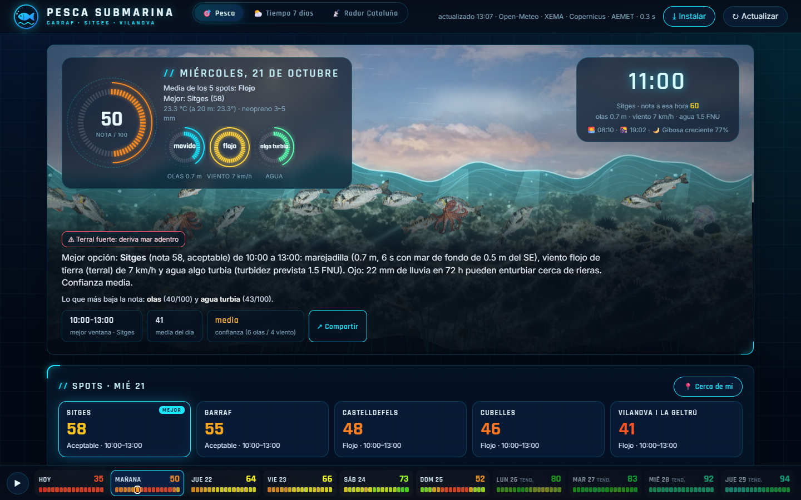
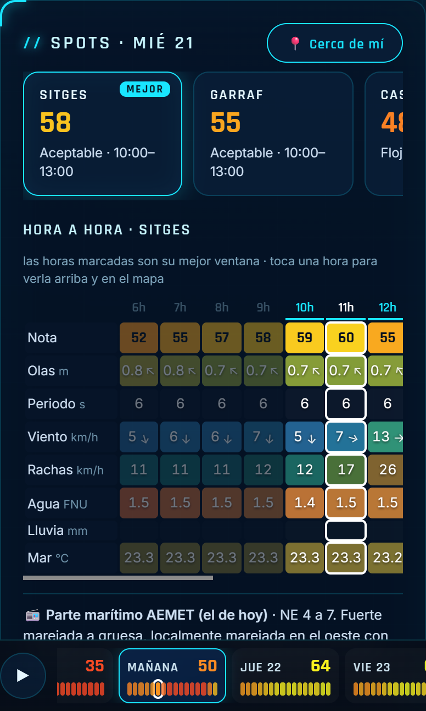
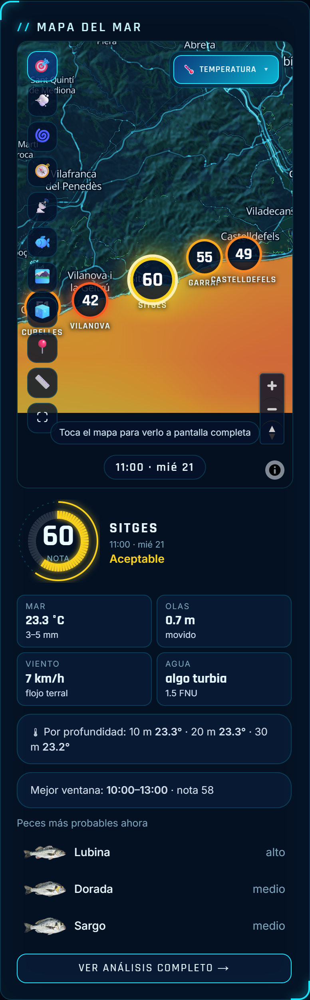
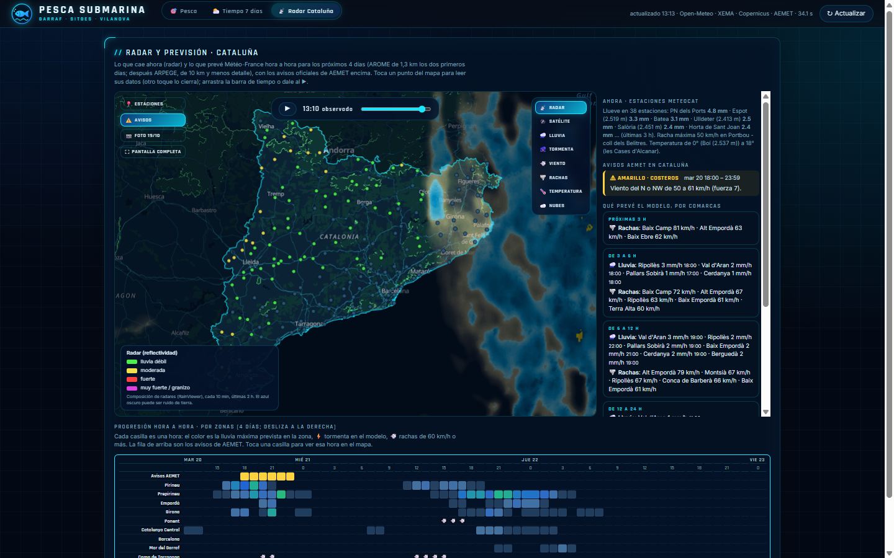
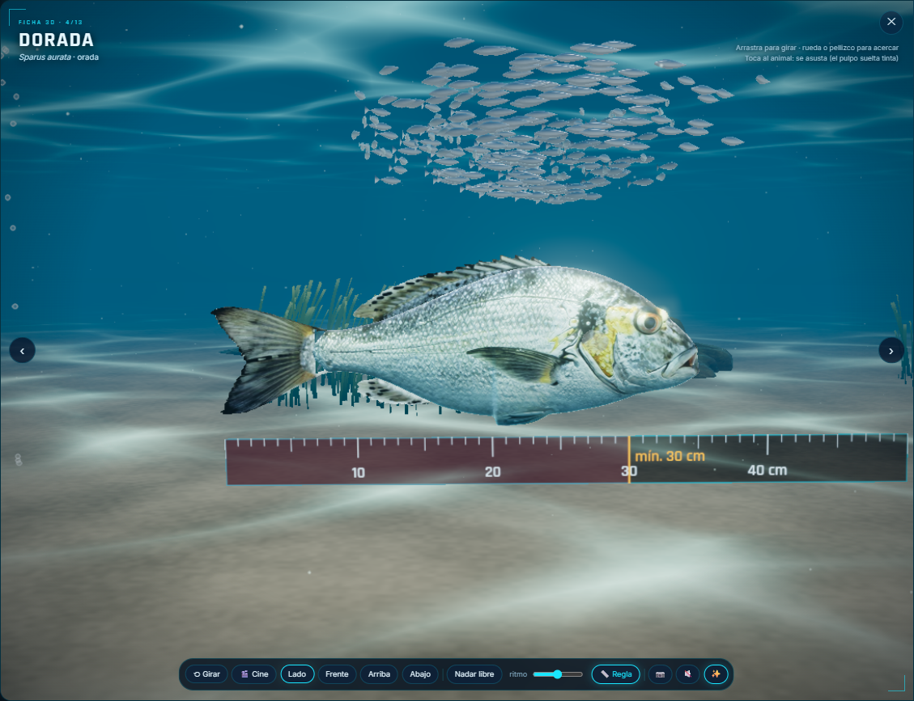

# Pesca Garraf

Tells me whether it's worth going spearfishing tomorrow, and where.

I spearfish on the Garraf coast near Barcelona, and answering "should I go?" meant checking several weather and sea forecasts and still guessing. Visibility is what makes or breaks a day underwater, and no forecast gives you that. So I built an app that gives every hour and every spot a score from 0 to 100, ten days ahead, using public weather, sea-state and satellite data.

  

  
  

  
  

The interface is in Spanish, since it's built for local use.

## What it does

- Scores five spots (Garraf, Sitges, Vilanova, Cubelles/Cunit, Castelldefels/Gavà) hour by hour for ten days. Days 7 to 10 are dimmed because they're a trend, not a forecast.
- Gives a plain-language verdict: best spot, best time window, what's dragging the score down, and how much the forecast models disagree.
- Has a sea map with bathymetry, sea temperature, waves, satellite water clarity, seabed type, animated wind and current, and a heat map of the best zones.
- Shows the official 7-day forecast and warnings, plus a Catalonia radar tab.
- Draws an animated sea scene that matches the selected hour: waves, wind, sun or moon, clarity, rain.
- Has 3D sheets for 13 species with season, depth and legal size.
- Installs as a PWA and works offline with the last data it saw.

## How the score works

Each hour becomes six factors between 0 and 1, which are combined with fixed weights and then clamped by safety caps. The core is in [`excerpts/score.js`](excerpts/score.js).

Water clarity carries 40%, waves 30%, wind 15%, current 8% and gusts 7%. The river is informational only, because it already feeds into clarity. Waves are scored on the median of several models, corrected with buoy readings, and short-period chop is penalised. Each spot has a seaward bearing, so swell coming from behind the coast counts for much less. Onshore wind hurts more than offshore wind.

Clarity is the interesting part, and the weakest. I blend a turbidity model fitted to Sentinel-2 satellite images (60%) with one fitted to historical lifeguard visibility reports (40%). Turbidity has memory, so the latest usable satellite image anchors the prediction and its weight fades over ten days. Long swell and river plumes push it down further.

On top of the weighted sum there are hard caps. A thunderstorm limits the score to 10, strong offshore wind to 35, gusts above 45 km/h to 20, swell above 1.5 m to 15, and official AEMET warnings cap it by level. Whatever the sum says, those win.

I'm upfront about the limits. The weights and thresholds are my own judgement, the turbidity model has a cross-validated R-squared of about 0.39, and the lifeguard model barely beats chance (AUC around 0.59).

## Under the hood

There's no database. Scheduled Python jobs pull the heavy datasets (Copernicus Marine, AEMET, Catalan weather stations, river discharge) and write static JSON snapshots. A small cached proxy handles the forecast APIs. The score itself is computed in the browser from those snapshots plus live forecast calls, so the app renders instantly from cache and refreshes in the background. [`excerpts/proxy_server.py`](excerpts/proxy_server.py) shows the proxy and the refresh scheduler.

Everything comes from public sources: Open-Meteo, AEMET OpenData, Meteocat open data, Copernicus Marine, Puertos del Estado, the Catalan Water Agency, EMODnet and ICGC for bathymetry, and RainViewer, EUMETSAT and NASA GIBS for radar and satellite. AEMET needs a free personal key, which isn't in this repo.

## Built with

Vanilla JavaScript (no framework, no build step), canvas and SVG, MapLibre GL, three.js, a service worker, and Python for the server and data jobs.

## What I'd do next

- The outings diary is still empty, so the score has no ground truth of its own. The next step is logging real dives with measured visibility, then recalibrating the weights and backtesting.
- Some Copernicus datasets I rely on retire in January 2027 and need migrating.
- The seabed legal-zone overlay is indicative only, not legal advice.

---

The full source is private. This repo shows how it works and a few pieces of the code; happy to walk through the rest.

© 2026 Arnau Mas
